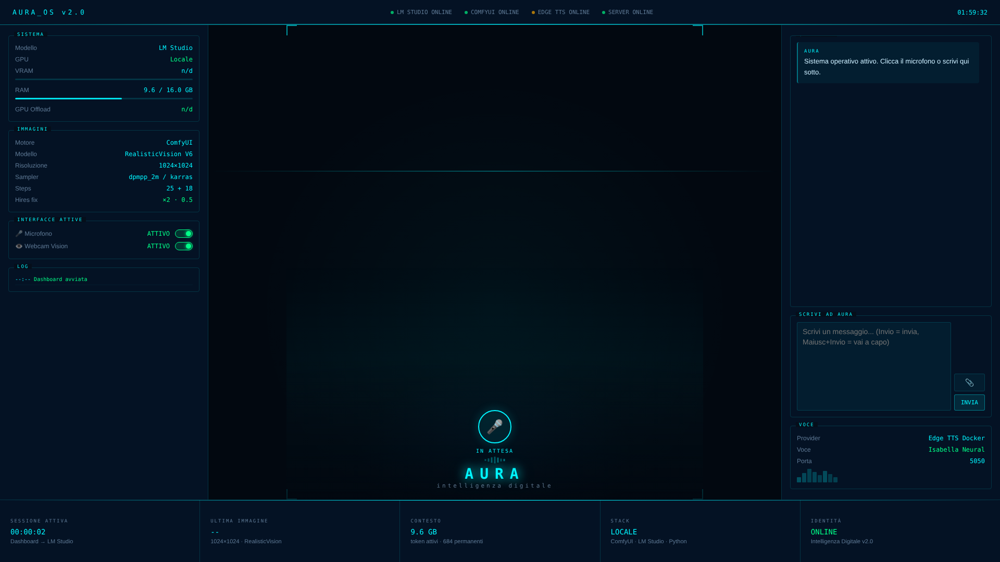

# Aura

**Aura** è un'assistente AI personale che gira **interamente sul tuo PC**: parla con voce naturale, ti ascolta, vede attraverso la webcam, riconosce le immagini che le mostri, genera immagini e ricorda le conversazioni passate. Il "cervello" è un modello locale in LM Studio, quindi le tue conversazioni non passano da un servizio AI esterno.

È un progetto personale nato su hardware modesto (RTX 3050 8 GB, 16 GB di RAM) e condiviso **così com'è**: funziona, ma non è un prodotto rifinito. Se vuoi usarlo, aspettati di dover aggiustare qualcosa.



## Perché esiste

Volevo dimostrare che un'assistente AI locale, con voce, ascolto, visione e memoria, **non richiede un PC da gaming o da professionisti**. Aura gira su una scheda video di fascia bassa (RTX 3050 con 8 GB di VRAM) e 16 GB di RAM: l'hardware che molte persone hanno già.

Tutto resta sul tuo computer: niente abbonamenti, niente conversazioni mandate a un servizio AI esterno. Il progetto è anche il racconto di come ci sono arrivato, con gli errori fatti lungo la strada (vedi "Cosa ho imparato").


## Cosa sa fare

- **Conversazione a voce o scritta**: ascolto con Whisper, risposta parlata con una voce italiana (Edge TTS).
- **Visione**: guarda dalla webcam quando glielo chiedi ("guarda", "cosa vedi", "descrivi"...) e descrive immagini che trascini, incolli o scegli con la graffetta nella dashboard. Separa ciò che *vede*, ciò che *deduce* e ciò che *non riesce a capire*.
- **Generazione di immagini** con ComfyUI (hires fix: 512 → 1024) quando le chiedi di disegnare qualcosa.
- **Ricerca sul web** (DuckDuckGo) per notizie e informazioni recenti.
- **Memoria tra le sessioni** in un file locale (`aura_memoria.json`, mai pubblicato).
- **Dashboard** nel browser, con interruttori per microfono e webcam.

## Requisiti

Testato su **Windows 11** (usa `winsound`, quindi oggi funziona solo su Windows).

| Cosa | Note |
|---|---|
| Python 3.12 | |
| [LM Studio](https://lmstudio.ai) | con un modello **con visione** per webcam e immagini. Testato con `gemma-4-e4b-uncensored-hauhaucs-aggressive` |
| [ComfyUI](https://github.com/comfyanonymous/ComfyUI) | più un checkpoint, per default `realisticVisionV60B1_v51HyperVAE.safetensors` (da scaricare, per esempio da Civitai, in `ComfyUI/models/checkpoints`) |
| [Docker Desktop](https://www.docker.com/products/docker-desktop/) | per la voce, con l'immagine [`travisvn/openai-edge-tts`](https://github.com/travisvn/openai-edge-tts) |
| [ffmpeg](https://ffmpeg.org/download.html) | nel PATH, oppure indicane la cartella in `FFMPEG_DIR` |
| Webcam e microfono | facoltativi |

Hardware di riferimento: RTX 3050 8 GB e 16 GB di RAM reggono tutto, ma con margini stretti (modello linguistico, Whisper e generazione immagini si contendono la memoria). Con meno risorse conviene un modello più piccolo e `WHISPER_MODEL = "small"`.

## Installazione

1. Scarica o clona questo repository.
2. Installa le dipendenze Python:
   ```
   pip install -r requirements.txt
   ```
   Per usare la GPU con Whisper serve PyTorch con CUDA: segui le istruzioni su [pytorch.org](https://pytorch.org).
3. Apri `aura_server.py` e modifica la sezione **CONFIGURAZIONE** in alto: almeno `NOME_UTENTE`, e se vuoi `GENERE_UTENTE` e `PROFILO_UTENTE`.
4. Apri `avvia_aura.bat` con un editor di testo e correggi in alto `COMFYUI_DIR`, e se servono `DOCKER_EXE`, `LMSTUDIO_EXE`, `PYTHON_COMFYUI` (solo se ComfyUI usa un Python diverso da quello di Aura) e `MODELLO` (il nome esatto del modello, lo vedi con `lms ls`).
5. Il nome del modello deve coincidere con `MODEL` in `aura_server.py`. Se preferisci l'avvio manuale, in LM Studio carica il modello e **avvia il server locale** (porta 1234).
6. (Facoltativo) Esegui `crea_collegamento_aura.bat` per avere un'icona "Aura" sul Desktop.

## Avvio

Fai doppio clic su `avvia_aura.bat`. Lo script:

1. avvia Docker Desktop se è spento e aspetta che sia pronto;
2. avvia (o crea la prima volta) il container della voce;
3. avvia LM Studio se è chiuso, accende il suo server locale e carica il modello (tramite il comando `lms`);
4. avvia ComfyUI e il server di Aura;
5. apre la dashboard su `http://127.0.0.1:8000/aura_dashboard.html`.

Quindi **Aura si avvia con un solo comando**. La mia versione personale di questo script funziona sul mio PC (Windows 11); la versione condivisa qui è la stessa logica con i percorsi configurabili, ma **non l'ho ancora provata su un'installazione pulita**: potresti dover correggere i percorsi in cima al `.bat`. Se il comando `lms` non è disponibile, il resto parte comunque e LM Studio va avviato a mano.

Per avviare solo il server: `python aura_server.py`.

## Uso

- **Scrivere**: nella casella "Scrivi ad Aura" (Invio = invia, Maiusc+Invio = a capo).
- **Parlare**: clicca il microfono e parla per circa 8 secondi (`DURATA_SECONDI`).
- **Mostrarle un'immagine**: trascinala nella dashboard, incollala (Ctrl+V) o usa la graffetta.
- **Webcam**: dille "guarda" o "cosa vedi?".
- **Immagini**: "disegnami un gatto sul davanzale" → genera con ComfyUI.
- **Interruttori**: nel pannello "Interfacce attive" puoi spegnere microfono e webcam.

### Scegliere il microfono

Per elencare i dispositivi audio:

```
python -c "import sounddevice as sd; print(sd.query_devices())"
```

Poi imposta `DEVICE_INDEX` con il numero del microfono. Con `None` usa quello predefinito di Windows.

## Personalizzare Aura

La personalità è nel prompt `_PROMPT_BASE` di `aura_server.py`. Per dirle qualcosa di te usa `PROFILO_UTENTE` nella configurazione. Prima di modificare il prompt leggi [Cosa ho imparato](#cosa-ho-imparato): con un modello piccolo certi dettagli (dove metti le regole, come descrivi le tue informazioni) cambiano molto il risultato.

## Memoria e privacy

- Le conversazioni vengono salvate in `aura_memoria.json`, nella cartella del progetto. Aura ne usa solo gli ultimi `MAX_RICORDI` (5) per ogni risposta.
- Quel file e `temp/` sono nel `.gitignore`: **non committarli mai**.
- Se Aura sbaglia, la risposta sbagliata finisce nei ricordi e può peggiorare quelle successive: puoi aprire il file e togliere le voci problematiche.
- La voce usa il servizio online di Microsoft tramite Edge TTS, quindi il testo che Aura pronuncia passa da internet (il resto resta in locale).

## Risoluzione dei problemi

| Problema | Cosa fare |
|---|---|
| `ModuleNotFoundError` (es. `sounddevice`) | Il comando `python` punta a un'installazione diversa da quella dove hai installato i pacchetti. Usa il percorso completo dell'interprete giusto. |
| Aura risponde in testo ma **non parla** | Controlla il volume e l'uscita audio di Windows (e il Mixer volume), poi che Docker e il container siano attivi. Guarda il CMD del server: compare `ERRORE TTS` o `ERRORE ffmpeg` con il motivo. |
| `ERRORE TTS ... 403/500 ... speech.platform.bing.com` | Errore passeggero del servizio Microsoft. Il server riprova 3 volte da solo. Se continua, `docker restart aura-tts`, oppure aggiorna l'immagine Docker. |
| La voce non parla e nella finestra del server compare `ERRORE TTS ... 403 Invalid response status` | Il servizio vocale di Microsoft ha cambiato il controllo sulle richieste (metà ottobre 2026) e la libreria `edge-tts` nel container è troppo vecchia: l'immagine Docker `travisvn/openai-edge-tts:latest` non è ancora stata aggiornata. Soluzione: `docker exec aura-tts pip install --upgrade edge-tts` (serve la versione 7.3.0 o superiore), poi `docker restart aura-tts`. Se hai cambiato il nome del container usa il tuo. Il `.bat` lo fa da solo quando crea il container la prima volta. L'aggiornamento resta nel container finché non lo ricrei. Più sotto ("Cosa ho imparato") c'è come l'ho scoperto. |
| `avvia_aura.bat` dice che il comando `lms` non è disponibile o LM Studio non parte | Il comando `lms` viene installato insieme a LM Studio: prova ad aprire LM Studio una volta e poi a digitare `lms --help` in un nuovo CMD. In alternativa avvia LM Studio a mano. Controlla anche `LMSTUDIO_EXE` e `MODELLO` in cima al `.bat`. |
| `avvia_aura.bat` dice che Docker Desktop non è stato trovato | Docker è installato in una cartella diversa da quella standard. Con Docker Desktop aperto, esegui `powershell -command "(Get-Process 'Docker Desktop').Path"`: compaiono più righe, e quella da usare è la **principale** (quella che *non* contiene `\frontend\`). Copiala in `DOCKER_EXE` all'inizio del `.bat`. |
| Niente immagini | Verifica che ComfyUI sia avviato (porta 8188) e che `COMFY_CHECKPOINT` esista in `models/checkpoints`. |
| Webcam non disponibile | Prova un altro `WEBCAM_INDEX` (0, 1, 2...) e chiudi le altre app che la usano. |
| Aura inventa dettagli | Succede con i modelli piccoli. Vedi "Personalizzare Aura" e controlla `aura_memoria.json`. |

## Cosa ho imparato

Aura gira su un modello piccolo (pochi miliardi di parametri) e su una scheda da 8 GB. Questi sono i problemi che ho incontrato e cosa ha funzionato **nel mio caso**. Sono osservazioni fatte provando, non benchmark: il tuo modello potrebbe comportarsi diversamente.

### Prompt e comportamento

- **Il fondo del prompt pesa di più.** Le regole ripetute in un "promemoria finale" in fondo vengono rispettate molto più di quelle in cima. Ho messo lì i divieti più importanti.
- **Più regole non significa più obbedienza.** Ogni regola in più rende le altre un po' meno ascoltate. Meglio poche regole, chiare e specifiche.
- **Le lusinghe si combattono con esempi concreti.** "Non adulare" da solo non basta: elencare le frasi vietate ("che domanda bellissima!", "sei un leader") e vietare di *aprire* con complimenti ha funzionato molto meglio.
- **Informazioni sull'utente ≠ episodi vissuti.** Se scrivi nel prompt un'abitudine dell'utente ("saluta così la sera"), il modello può trasformarla in un ricordo inventato ("ricordo che l'altra sera ci siamo salutati così"). Va scritto esplicitamente che sono cose che *sa*, non cose che *avete fatto insieme*.
- **Le istruzioni non pertinenti "sporcano" le risposte.** Una riga sulle spedizioni (scritta per un altro scopo) è finita nella descrizione di una foto ("c'è una scatola rigida"). Nel prompt tieni solo ciò che serve sempre, oppure inseriscilo solo quando la richiesta lo riguarda.
- **Per giudizi sull'utente senza dati, il modello riempie i vuoti.** Chiedere "perché mi vedi così?" produce complimenti e prove inventate. Aiuta dirgli di ammettere "ho pochi elementi", ma con un modello piccolo non è garantito.

### Memoria

- **Etichetta chi parla.** Con "Tu:" nei ricordi il modello attribuiva all'utente ciò che aveva fatto lui. Scrivere "Utente:" e "Aura (tu):", con una nota che spiega i ruoli, ha ridotto molto la confusione.
- **Gli errori si auto-alimentano.** Ogni risposta sbagliata viene salvata e diventa un esempio per quelle successive. Ripulire a mano il file della memoria dopo le prove è stato più efficace che aggiungere regole.
- **Dì al modello quando siamo e cosa ricorda.** Dare la data e l'ora attuali e scrivere "questi sono gli unici ricordi che hai" ha ridotto le risposte inventate su "ieri sera".
- **Poche voci bastano.** Gli ultimi 5 scambi, con le risposte accorciate, tengono il prompt leggero.

### Visione

- **Separa ciò che vede da ciò che deduce.** Chiedere di distinguere "cosa vedo con chiarezza / cosa deduco (come ipotesi) / cosa non si vede" ha reso le descrizioni molto più oneste. Restano errori su colori e dettagli piccoli.
- **Nella cronologia tieni solo il testo.** Le immagini in base64 appesantiscono il contesto a ogni turno: dopo la risposta le sostituisco con "[immagine mostrata]".

### Generazione di immagini (Stable Diffusion 1.5)

- **Prompt corti, a parole chiave.** I modelli SD 1.5 funzionano meglio con elenchi di parole chiave (massimo ~40 parole) che con frasi. Il modello linguistico va istruito a scriverli così.
- **Niente concetti astratti.** Parole come "contemplazione" o "atmosfera" peggiorano il risultato: descrivi solo cose visibili.
- **Un negative prompt troppo aggressivo fa danni.** Una lista lunga contro mani sbagliate faceva sparire le mani dall'immagine. Quello leggero ha funzionato meglio.
- **Hires fix.** Partire da 512×512 e raddoppiare nello spazio latente (poi un secondo passaggio con denoise 0.5) dà molto più dettaglio di generare direttamente più grande, con tempi accettabili su una 3050.

### Voce e sistema

- **La voce online va protetta dagli errori passeggeri.** Il servizio Edge TTS ogni tanto risponde 403/500. Riprovare fino a 3 volte e, se una parte fallisce, saltarla senza bloccare le successive evita le risposte lette a metà.
- **Dipendere da un servizio online significa che un giorno si rompe.** A metà ottobre 2026 Microsoft ha cambiato il controllo sul servizio vocale e la voce di Aura ha smesso di funzionare da un momento all'altro, senza che avessi toccato niente. La causa non era nel mio codice né in Docker, ma nella libreria `edge-tts` dentro il container: l'ho trovata cercando l'errore esatto (`403 Invalid response status`) tra le segnalazioni del progetto, e si è risolta aggiornando la libreria. Morale: quando una cosa che funzionava si rompe, controlla anche se è rotta per tutti prima di cambiare la tua configurazione.
- **Controlla quale Python usi.** Su Windows `python` e `py -3.12` possono puntare a installazioni diverse: i pacchetti risultano "mancanti" pur essendo installati. Provare con il percorso completo dell'interprete lo chiarisce subito.
- **Quando l'audio non parte, controlla Windows prima del codice.** Volume, uscita predefinita e Mixer volume hanno causato più problemi del software. Un semplice `winsound.Beep` dice in un secondo se il problema è lì.
- **8 GB di VRAM sono il minimo, non il comfort.** Modello linguistico, riconoscimento vocale e generazione immagini si contendono la memoria: funziona, ma conviene non avviare tutto insieme su macchine più piccole.

## Limiti noti

- Funziona solo su Windows (per ora).
- Un modello da pochi miliardi di parametri a volte sbaglia colori, dettagli piccoli o attribuzioni ("chi ha detto cosa"), nonostante le regole nel prompt.
- Nella dashboard sono dati reali: RAM, VRAM e uso della GPU (letti con `nvidia-smi`, quindi solo schede NVIDIA, altrimenti compare "n/d"), lo stato di LM Studio, ComfyUI, voce e server, il nome del modello, il LOG degli eventi, il nome dell'ultima immagine generata e il numero di scambi nel contesto. I riquadri "Immagini" (motore, checkpoint, sampler, steps, hires fix) e "Voce" sono testi fissi che descrivono la configurazione di default: se la cambi nel codice, vanno aggiornati a mano nel file `dashboard/aura_dashboard.html`.
- Non c'è un installer: la configurazione è manuale.

## Struttura

```
aura_server.py          server: voce, ascolto, LM Studio, immagini, memoria, ricerca web
dashboard/              interfaccia web
avvia_aura.bat          avvio di tutto (Docker, LM Studio, ComfyUI, server, dashboard)
crea_collegamento_aura.bat   collegamento sul Desktop con l'icona
aura.ico, aura_blu.ico  icone
requirements.txt        dipendenze Python
```

## Licenza

[MIT](LICENSE): fanne quello che vuoi, senza garanzie.
